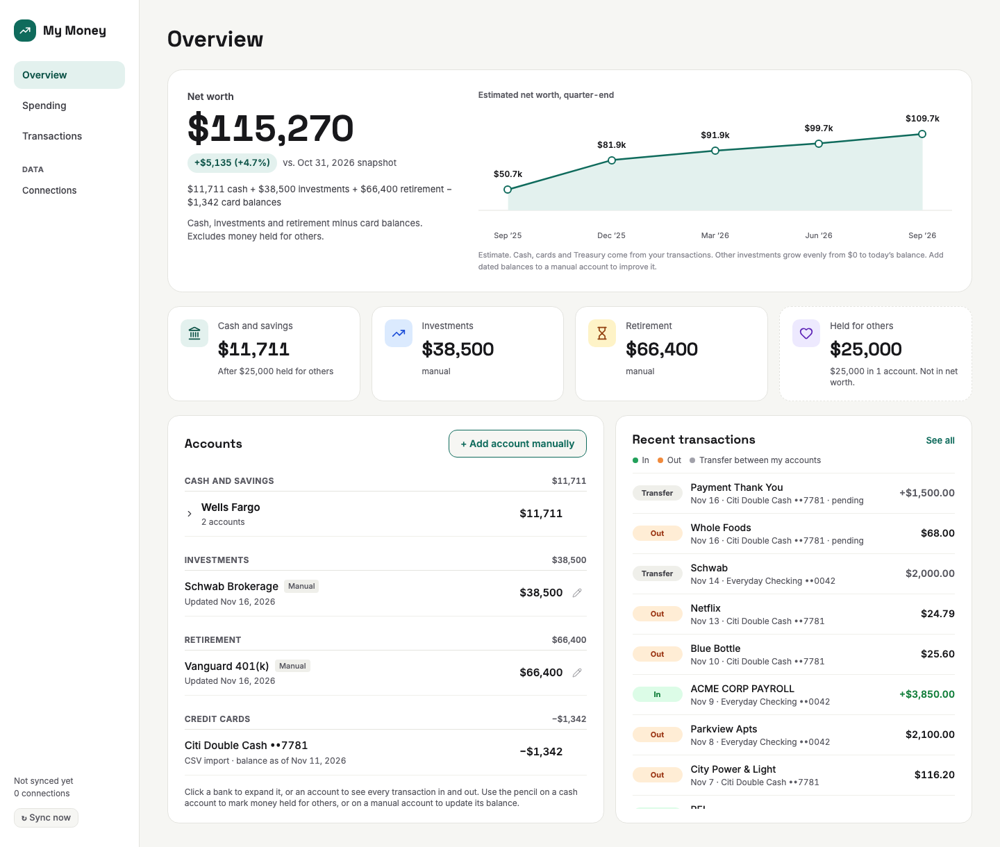
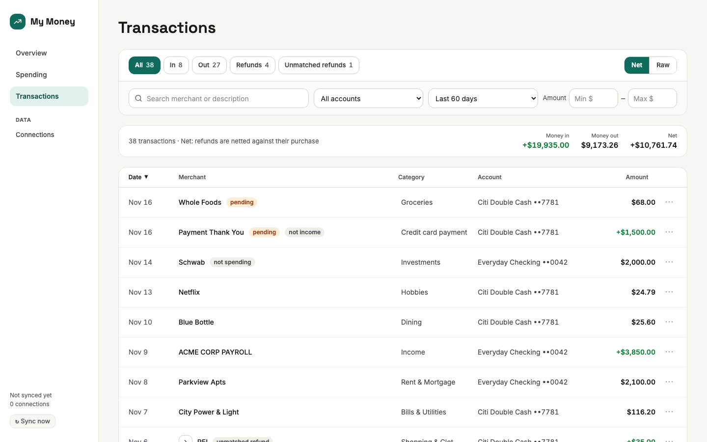

# My Money

A personal finance dashboard that runs only on your computer.

- **Net worth** across banks, cards, investments and manual accounts, leaving out money you hold for others.
- **Spending** that nets refunds against the original purchase, by month and category.
- **Savings**: how much you saved, and how much went to investments vs stayed in cash.
- **Your data stays local**: one SQLite file on your machine. No hosting, no account, no paid service.

Built with Next.js, TypeScript and SQLite. Bank data comes from [Plaid](https://plaid.com) (read-only).



| Spending | Transactions |
|---|---|
|  |  |

_Screenshots use the built-in sample data. No real accounts._

## Try it with sample data

No bank or Plaid keys needed. Requires Node.js 20+.

```bash
npm install
```

```bash
npm run demo
```

Open **http://127.0.0.1:3001**.

- The demo writes made-up data to `data/demo.db`. It never touches a real database.
- Running `npm run demo` again resets the sample data.

## Connect your own accounts

1. Get Plaid API keys: sign in at [dashboard.plaid.com](https://dashboard.plaid.com) → **Developers → Keys**.
2. Create your env file and paste in `PLAID_CLIENT_ID` and `PLAID_SECRET`:

   ```bash
   cp .env.example .env.local
   ```

   - `PLAID_ENV=sandbox` uses Plaid's fake test banks.
   - `PLAID_ENV=production` uses your real banks. Plaid's free Trial plan has a connection limit.
3. Start the app:

   ```bash
   npm run dev
   ```

4. Open **http://127.0.0.1:3000** → **Connections** → **Connect a bank or card**.
5. Click **Sync now** whenever you want fresh data, or run `npm run sync`.

**Accounts Plaid can't reach** (401k, Treasury bills, property): add them on the Overview with **Add account manually**, and record dated balances.

**Good to know:**

- Some banks send no pending charges, and some share only about 90 days of history.
- Investment accounts share balances only. Trades need Plaid's paid Investments product, which this app doesn't use.

## Security

- **Local only.** The app listens on `127.0.0.1`, so other devices can't reach it. Next.js telemetry is off.
- **Read-only bank access.** The Plaid client only allows four read-only endpoints (`lib/connectors/plaid/client.ts`). Nothing can move money.
- **Secrets stay out of git.** Plaid keys live in `.env.local`. Bank access tokens live in `secrets/plaid-tokens.json` (file mode 600). The database lives in `data/`. All three are gitignored.
- **No cross-site requests.** API calls that change data must come from the app's own pages (`middleware.ts`).
- **Raw transactions are never edited.** Category changes, refund matches and exclusions are stored separately and can be undone.

## Development

```bash
npm test
```

```bash
npm run typecheck
```

- Requirements and design decisions: [docs/PRD-v2.md](docs/PRD-v2.md).
- Mockups: `design/`.
