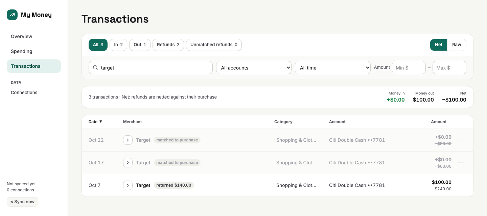
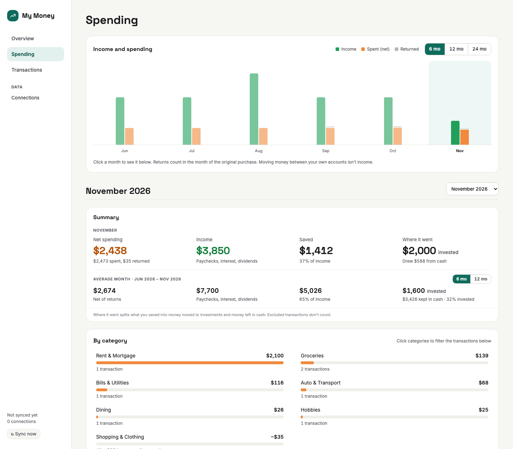

# My Money

A personal finance dashboard that runs only on your own computer. You don't need to know how to code to use it: follow the steps below.

- **Net worth** across banks, cards, investments and accounts you add by hand, leaving out money you hold for others.
- **Spending** by month and category, with refunds matched to what you bought (see below).
- **Savings**: how much you saved, and how much went to investments vs stayed in cash.
- **Private by design**: your data stays in one file on your computer. No account to sign up for, nothing hosted, nothing to pay.


_All screenshots use built-in sample data, not real accounts._

## Returns, handled for you

If you shop a lot, returns make most budgeting apps look wrong: you "spent" $240, got $140 back two weeks later, and the app shows both as separate lines in different months. My Money matches them up.



- **Refunds are matched to the purchase automatically.** Above: a $240 order shows as **$100** with a "returned $140" tag. The two refunds are greyed out, so nothing is counted twice.
- **Returns count in the month you bought the item.** Your October spending is what you actually kept from October.
- **Partial and multiple returns work.** Send back two items from one order, at different times.
- **Different wording is fine.** "SP STORE CLOTHING" on the refund still matches "Store" on the purchase.
- **Anything unclear is left for you.** Unmatched refunds get their own filter, and you can match, unmatch or link one by hand in a click.
- **Friends paying you back isn't a refund.** Venmo or Zelle money from people is kept separate from store returns.

| Spending | Transactions |
|---|---|
|  |  |

## Try it with sample data (about 10 minutes)

You'll type a few commands into **Terminal**, the Mac app for typing commands (find it with Spotlight: press Cmd+Space, type "Terminal").

1. **Install Node.js**, the engine that runs the app.
   - Go to [nodejs.org](https://nodejs.org), download the **LTS** version, and install it like any app.
2. **Download this project.**
   - At the top of this page, click the green **Code** button → **Download ZIP**.
   - Double-click the ZIP to unzip it.
3. **Open Terminal in the project folder.**
   - In Terminal, type `cd ` (with a space after it), drag the unzipped folder onto the Terminal window, and press Enter.
4. **Install the app's parts.** This takes a few minutes the first time:

   ```bash
   npm install
   ```

5. **Start the demo:**

   ```bash
   npm run demo
   ```

6. **Open http://127.0.0.1:3001** in your browser.

**To stop the app,** click in Terminal and press **Ctrl+C**. Running `npm run demo` again resets the sample data.

## Connect your own accounts

The app reads your bank data through **Plaid**, the service many finance apps use to connect to banks. You need your own free Plaid keys: two codes that let the app ask Plaid for **your** data. Nobody else sees them.

### 1. Get your Plaid keys

1. Sign up at [dashboard.plaid.com](https://dashboard.plaid.com).
2. In the left menu, go to **Developers → Keys**.
3. You'll see a **client_id** and a few **secrets**. Keep this page open.
   - **Sandbox** secret: for practice with fake banks. Start here.
   - **Production** secret: for your real banks. Plaid's free Trial plan allows a limited number of bank connections.

### 2. Put the keys in the app

In Terminal, inside the project folder, run:

```bash
cp .env.example .env.local
```

```bash
open -e .env.local
```

This makes your own settings file and opens it in TextEdit. Fill in three lines, then save and close:

```
PLAID_CLIENT_ID=paste your client_id here
PLAID_SECRET=paste your Sandbox secret here
PLAID_ENV=sandbox
```

### 3. Start the app and connect

```bash
npm run dev
```

1. Open **http://127.0.0.1:3000**.
2. Go to **Connections** → **Connect a bank or card**.
3. With Sandbox keys, pick any bank and sign in with Plaid's test login: username `user_good`, password `pass_good`.
4. Click **Sync now** in the sidebar whenever you want fresh data.

### 4. Switch to your real banks

When the practice run works:

1. In `.env.local`, paste your **Production** secret and change the last line to `PLAID_ENV=production`.
2. Stop the app (Ctrl+C) and start it again with `npm run dev`.
3. Connect your real banks the same way. You sign in on your bank's own page, inside Plaid's window. The app never sees your bank password.

**Accounts Plaid can't reach** (a 401k, Treasury bills, a house): click **Add account manually** on the Overview and enter the balance. Add a new dated balance now and then to track it over time.

### Good to know

- Some banks don't send pending charges, and some share only about 90 days of past transactions.
- Investment accounts share balances, not individual trades.
- Your bank data lives in the `data` folder, and your bank connections in the `secrets` folder. Back them up if you like, but never share or upload them.

## Security

- **Only your computer can open it.** The app runs at `127.0.0.1`, which other devices can't reach.
- **Read-only.** The app is only allowed to read data from Plaid. It can't move money.
- **Your keys and data never go online.** `.env.local`, `secrets/` and `data/` are excluded from git, so they can't be uploaded by accident.
- **Your original transactions are never changed.** Categories, refund matches and exclusions are saved separately and can be undone.

## For developers

```bash
npm test
```

```bash
npm run typecheck
```

- Built with Next.js, TypeScript and SQLite. The Plaid client allows only four read-only endpoints (`lib/connectors/plaid/client.ts`).
- Requirements and design decisions: [docs/PRD.md](docs/PRD.md) (every tab and how each number is calculated). Mockups: `design/`.
